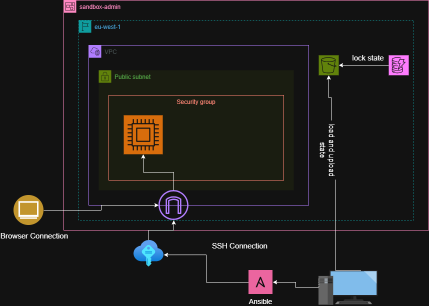

# Advanced IaC with Terraform and Ansible

Provisions an Amazon Linux 2 EC2 instance on AWS with **Terraform**, then configures it as an **Nginx** web server with **Ansible**, using an SSH key pair generated by Terraform. The two tools are deliberately kept separate: Terraform builds the infrastructure, Ansible configures the server, and Terraform hands Ansible everything it needs (the private key and a generated inventory) so no values are copied by hand.

**Author:** Kabera Clapton

---

## Architecture



**Flow**

1. Terraform creates the network (VPC, public subnet, internet gateway, route table), a security group, an ED25519 key pair, and the EC2 instance. State is stored remotely in S3 with native lockfile locking.
2. Terraform writes the private key locally (`0400` permissions) and renders `ansible/inventory.ini` from a template containing the instance's public IP and the absolute key path.
3. Ansible connects over SSH, installs Nginx, enables and starts the service, and deploys a templated web page. A handler restarts Nginx only when the deployed content changes.
4. The page is served over HTTP on port 80.

---

## Tools and Versions

| Tool | Version | Notes |
| --- | --- | --- |
| Terraform | >= 1.10 | Required for S3 native state locking (`use_lockfile`) |
| AWS provider | ~> 6.x | Plus `http`, `tls` and `local` providers |
| ansible-core | 2.16.x | Last line supporting Python 2.7 targets, which AL2's `yum` needs |
| AWS CLI | v2 | Used by the backend bootstrap and cleanup scripts |

---

## Repository Structure

```
.
├── README.md
├── advancedIaC.png
├── .gitignore
├── terraform/
│   ├── backend.tf            # S3 remote backend
│   ├── main.tf               # network, security group, key pair, EC2, inventory
│   ├── variables.tf
│   ├── outputs.tf
│   ├── inventory.tftpl       # template rendered to ansible/inventory.ini
│   ├── s3_setup.sh           # bash script that sets up the s3 bucket for remote state
│   ├── clean_up.sh           # bash script for cleaning up the s3 bucket
│   └── .terraform.lock.hcl   # pinned provider versions
├── ansible/
│   ├── ansible.cfg
│   ├── inventory.ini         # generated by Terraform (git-ignored)
│   ├── site.yml
│   └── roles/
│       └── nginx/
│           ├── defaults/main.yml
│           ├── tasks/main.yml
│           ├── handlers/main.yml
│           └── templates/index.html.j2
└── evidence/
    ├── apply.txt
    ├── destroy.txt
    ├── ansible-run.txt
    └── browser-output.png
```

---

## Prerequisites

- An AWS account and credentials configured for the AWS CLI (`aws configure` or environment variables)
- Terraform >= 1.10
- Python 3.10+ for the Ansible control node
- `jq` (used by `clean_up.sh`)

Install Ansible in a virtual environment so the pinned version doesn't conflict with anything else on your machine:

```bash
python3 -m venv .venv
source .venv/bin/activate
pip install "ansible-core==2.16.*" ansible-lint
```

---

## Usage

It is advised to run the terraform commands under the `terraform/` directory and the ansible commands under the `ansible/` dirctory.

### 1. Create the remote state bucket (in the terraform directory)

```bash
./s3_setup.sh
```

### 2. Provision the infrastructure

```bash
terraform init
terraform plan
terraform apply | tee evidence/apply.txt
```

Terraform prints the following outputs:

| Output | Description |
| --- | --- |
| `public_ip` | Public IPv4 address of the instance |
| `public_dns` | Public DNS name of the instance |
| `ssh_user` | SSH user for Amazon Linux 2 (`ec2-user`) |
| `key_name` | Name of the AWS key pair |
| `key_path` | Absolute path to the generated private key |

### 3. Configure the server (in the ansible directory)

Remember to activate the venv.

```bash
cd ansible
ansible all -m ping                                   # confirm SSH connectivity
ansible-playbook site.yml --syntax-check
ansible-lint
ansible-playbook site.yml | tee ../evidence/ansible-run-1.txt
```

### 4. Confirm idempotence

```bash
ansible-playbook site.yml
```

The second run should report `changed=0`, showing the playbook only changes what is out of date.

---

## Verification

```bash
curl -i http://$(terraform -chdir=terraform output -raw public_ip)
```

Expect `HTTP/1.1 200 OK` with a `Server: nginx` header. Then open `http://<public_ip>` in a browser.

Browser
 |

---

## Cleanup

Destroy everything Terraform created, then remove the state bucket:

```bash
terraform destroy | tee evidence/destroy.txt
./clean_up.sh
```

`terraform destroy` removes all 14 managed resources: the instance, key pair, security group and its rules, route table and association, internet gateway, subnet, VPC, the TLS key, and the local key and inventory files. The S3 bucket is created by a script rather than by Terraform, so it is removed separately, after the destroy has finished writing state.

---

## Design Decisions

- **Clear separation of concerns.** The instance has no `user_data`. All configuration is done by Ansible, so each tool has one job and the configuration can be re-applied or changed without rebuilding the server.
- **Terraform-generated SSH key.** An ED25519 key is generated with the `tls` provider, registered as an AWS key pair, and written locally with `0400` permissions. The private key is never committed. Note that it is stored in Terraform state, which is why the state bucket is private and encrypted.
- **Generated inventory.** `inventory.ini` is rendered from `inventory.tftpl` with the instance IP and the absolute key path, removing a manual, error-prone hand-off between the two tools.
- **Restricted SSH.** Port 22 is open only to the operator's current public IP, looked up at apply time. Port 80 is open to everyone because the site is public.
- **Remote state with locking.** State lives in a versioned S3 bucket with S3-native locking, so there is no DynamoDB table to manage.
- **Idempotent configuration.** Every task is safe to re-run; the Nginx install uses `creates:` so it is skipped once Nginx is present.
- **Handler-driven restarts.** Nginx is restarted only when deployed content changes, not on every run.
- **Host key checking disabled.** Each apply creates a new instance with a new host key, so checking is turned off in `ansible.cfg`. This is acceptable for a short-lived lab but would not be used in production.
- **Amazon Linux 2.** The write-up specifies AL2, which reached end of standard support on 30 June 2026. For new work, Amazon Linux 2023 would be the better choice; it uses `dnf` and does not need the Python 2 interpreter or `amazon-linux-extras`.

---
